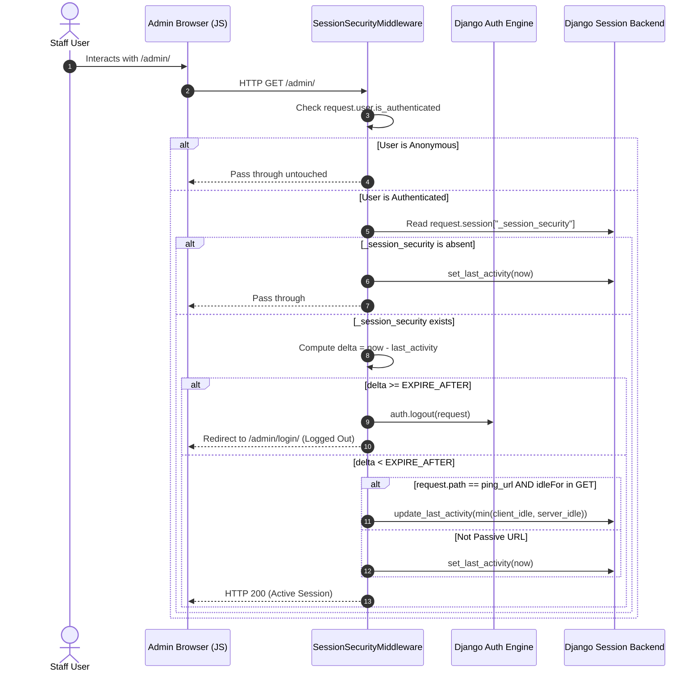

# Production Architecture & Security Deep Dive: django-session-security

## 1. Request Flow & Session Inactivity Tracking
`django-session-security` enforces server-side session expiration by intercepting incoming HTTP requests via `SessionSecurityMiddleware` (positioned immediately after `django.contrib.auth.middleware.AuthenticationMiddleware`).

### Where Last Activity Is Stored
- The timestamp is stored directly in Django's session dictionary at `request.session["_session_security"]`.
- Format: ISO 8601 string (`YYYY-MM-DDTHH:MM:SS.mmmmmm`) via Python's `datetime.strftime('%Y-%m-%dT%H:%M:%S.%f')`.
- It is saved and persisted across requests using Django's session engine (PostgreSQL session table or Redis).

### When the Middleware Updates the Timestamp
- On standard (non-passive) requests: every HTTP request updates `_session_security` to `datetime.now()`.
- On ping requests (`/session_security/ping/?idleFor=N`): the middleware reads `request.GET["idleFor"]` and computes whether the client has more recent user activity than the server's session record.

### When the Middleware Calls `logout()`
- If `now - last_activity >= EXPIRE_AFTER`, `self.do_logout(request)` is invoked.
- `do_logout(request)` calls `django.contrib.auth.logout(request)`, which purges `_auth_user_id` and flushes session state.
- The user is immediately redirected to the admin login page (`/admin/login/?next=...`).

### Passive URLs (`SESSION_SECURITY_PASSIVE_URL_NAMES`)
- Background polling endpoints (e.g. status checkers, progress bars) can be declared in `SESSION_SECURITY_PASSIVE_URL_NAMES`.
- When an incoming request matches a passive URL, the middleware checks expiration, but does **not** refresh the activity timestamp, preventing automated background polling from keeping an abandoned session alive indefinitely.

---

## 2. Multi-Tab Synchronization & The Ping Mechanism
In modern web applications, an administrator frequently opens multiple admin tabs simultaneously (e.g., viewing tenant list in Tab A while editing course content in Tab B).

1. **Client-Side Event Capture (`script.js`)**:
   - `session_security/script.js` listens to document events: `mousemove`, `scroll`, `keydown`, `click`, `touchstart`.
   - When an event occurs, it records a local JavaScript timestamp: `this.lastActivity = new Date()`.
2. **Periodic Heartbeat Ping**:
   - Every few seconds, the script computes `idleFor = Math.floor((new Date() - this.lastActivity) / 1000)`.
   - It issues an AJAX `GET /session_security/ping/?idleFor=N`.
3. **Server Reconciliation**:
   - `SessionSecurityMiddleware.update_last_activity` calculates:
     $$\text{server\_idle\_for} = (\text{now} - \text{last\_activity})_{\text{seconds}}$$
   - If $\text{client\_idle\_for} < \text{server\_idle\_for}$, the client performed user activity more recently than the last server request. The server rewinds `last_activity` to $\text{now} - \text{client\_idle\_for}$.
   - The view returns the consolidated seconds since activity across all tabs.
4. **Result**: Activity in Tab B refreshes the session on the server. When Tab A performs its next ping, the server reports the fresh timestamp, automatically resetting Tab A's countdown timer and preventing false-positive logouts across multiple tabs.

---

## 3. Server-Side Enforcement vs. Client-Side Warning Dialog
- **The Client-Side Dialog Is Advisory**:
  - The modal dialog rendered by `session_security/all.html` is merely an ergonomic warning to notify the user that their session is about to expire (`WARN_AFTER` seconds reached).
  - The browser JS can be bypassed, disabled, paused, or suspended (e.g. laptop lid closed, tab frozen by browser memory savers).
- **The Server-Side Middleware Is the Hard Security Boundary**:
  - Even if the browser tab is frozen, closed, or tampered with, the server evaluates `delta = now - last_activity` on every subsequent HTTP request.
  - An attacker attempting to reuse an idle session on an unattended machine is immediately blocked and logged out upon submitting their request.

---

## 4. Why django-session-security Does Not Affect the REST API (JWT)
`SessionSecurityMiddleware` has zero effect on Klaribase's `/api/...` endpoints:
- **Middleware Execution Hierarchy**:
  1. `SessionSecurityMiddleware` runs at the Django middleware layer.
  2. At this stage, `AuthenticationMiddleware` has only examined the Django session cookie (`sessionid`).
  3. API clients transmit credentials via HTTP `Authorization: Bearer <JWT>`, not session cookies.
  4. Consequently, `request.user.is_authenticated` evaluates to `False` (`AnonymousUser`) during middleware processing.
  5. `SessionSecurityMiddleware` checks `if not self.is_authenticated(request): return` and immediately passes the request downstream without touching session state.
- **DRF View-Level Authentication**:
  - JWT authentication occurs later inside Django REST Framework view dispatchers (`rest_framework_simplejwt.authentication.JWTAuthentication`).
- **JWT Session Boundaries**:
  - API token lifetimes are governed strictly by `SIMPLE_JWT` settings:
    - Access token lifetime: 5 minutes (`ACCESS_TOKEN_LIFETIME = timedelta(minutes=5)`).
    - Refresh token lifetime: 24 hours (`REFRESH_TOKEN_LIFETIME = timedelta(days=1)`).
    - Token rotation and blacklisting: `ROTATE_REFRESH_TOKENS = True` and `BLACKLIST_AFTER_ROTATION = True`.

---

## 5. Architectural Invariants, Limitations & Threat Vectors

### A. Honest Browser vs. Hostile Client
- The `idleFor` mechanism trusts the parameter sent by the HTTP client.
- A malicious actor who has stolen the session cookie, or a malicious browser extension executing on the machine, can issue automated `GET /session_security/ping/?idleFor=0` requests to maintain the session perpetually.
- `django-session-security` is designed specifically to mitigate **unattended physical workstation compromise** (the "honest user walks away from their desk" scenario), not XSS or stolen session token persistence.

### B. Naive `datetime.now()` Caveat
- The package calculates deltas using naive local system time: `datetime.now()`.
- If the host system clock undergoes sudden non-monotonic jumps (Daylight Saving Time transitions, NTP step adjustments, or host VM time sync anomalies), the idle delta calculation can abruptly spike or drop.

### C. Unsaved Form State
- When an expiration occurs while an administrator is drafting a lengthy course description or LMS configuration form, `script.js` checks `confirmFormDiscard`.
- However, if the session has expired on the server, subsequent form submission will result in a redirect to the login screen, discarding unsaved form state. Administrative users must be warned of this operational tradeoff.

---

## 6. Configuration Settings & Usability Tradeoffs

### OWASP Guidance
According to the **OWASP Session Management Cheat Sheet**:
> *"For high-value applications or administrative portals handling sensitive operational data, inactivity timeouts should range between 2 and 15 minutes."*

### Proposed Values
- **`SESSION_SECURITY_WARN_AFTER = 540` (9 Minutes)**: Displays warning modal when the user has been inactive for 9 minutes, providing a 60-second window to retain the session by mouse movement or keypress.
- **`SESSION_SECURITY_EXPIRE_AFTER = 600` (10 Minutes)**: Performs immediate server-side logout after 10 minutes of total inactivity.
- **Environment Override**: Configurable via `SESSION_SECURITY_WARN_AFTER` and `SESSION_SECURITY_EXPIRE_AFTER` environment variables, enabling shorter timeouts during automated end-to-end tests without modifying source code.

---

## 7. Explain-Back Questions for Santosh (AIERA-6 Routine)
*Answer these questions before approving and merging PR #3:*

1. Why does `SessionSecurityMiddleware` have to be placed after `AuthenticationMiddleware` in `settings.MIDDLEWARE`, and what happens if their order is reversed?
2. If an administrator has three admin tabs open and actively edits a form in Tab 1, why doesn't Tab 2 log them out when its local timer reaches `EXPIRE_AFTER`?
3. How does the system ensure that API clients authenticating with `Authorization: Bearer <jwt>` to `/api/accounts/me/` never trigger session creation or middleware logout?
4. If an attacker extracts the `sessionid` cookie from an unattended laptop and writes a script that runs `curl -b "sessionid=..." https://app/session_security/ping/?idleFor=0` every 30 seconds, does `django-session-security` log them out? Why or why not?
5. Why must `SESSION_EXPIRE_AT_BROWSER_CLOSE` strictly be set to `True`, and what exception does `django-session-security` raise if it is omitted?
